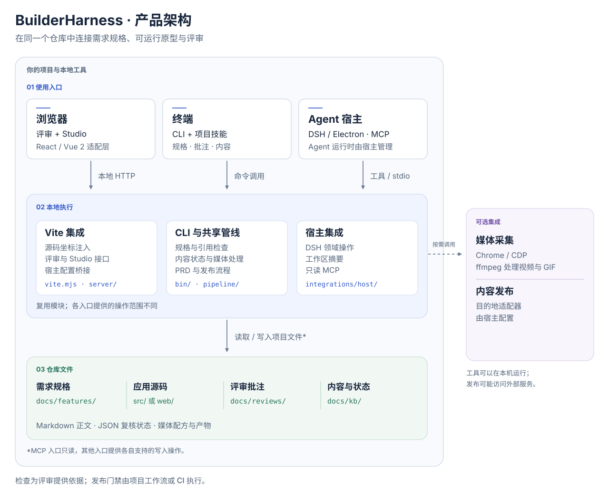

# BuilderHarness

**面向产品构建者的 Agent Harness。**

在同一个仓库中连接需求规格、可运行原型和源码批注。BuilderHarness 为编程 Agent
提供项目上下文，为维护者提供评审、引用检查和文档更新工具，让实现与需求更容易核对。

[](./LICENSE)

[English](./README.md) · [快速开始](./docs/getting-started.zh-CN.md) · [架构说明](./docs/architecture.md) · [贡献指南](./CONTRIBUTING.md)

## 能做什么

| 能力 | 已提供的功能 |
| :-- | :-- |
| 定义需求 | 功能需求规格（FRS）模板、验收标准，以及规格、路由和截图引用检查。 |
| 评审运行中的应用 | 选择页面元素并添加源码批注；源码位置变化时，按组件语义或几何位置降级定位。 |
| 配合编程 Agent | 通过 CLI、项目技能或 Agent 宿主，导出待处理批注并提供源码、规格和内容上下文。 |
| 跟踪变更 | 发现失效引用、发生变化的源码依赖，以及需要复核或重新生成的媒体。 |
| 准备交付物 | 生成 PRD 和配方驱动的媒体，维护 Markdown 指南与发布说明；通过已配置的目的地适配器发布。 |

基本流程是 **定义需求 → 实现 → 评审 → 检查 → 人工确认**。
检查结果为维护者提供判断依据，具体如何接入开发流程和发布门禁由项目决定。

## 运行演示

以下步骤使用 **Node.js 22 或更高版本**和 npm。演示在本地运行，无需模型 API Key
或发布平台账号。

```bash
git clone https://github.com/guoxuedong2018/BuilderHarness.git
cd BuilderHarness
npm ci
npm run demo
```

打开 Vite 输出的本地地址，通常是 `http://localhost:5173/#/overview`。
选择页面元素添加批注，再打开 Studio 查看演示内容与引用。按 `Ctrl+C` 停止服务。


接入已有项目请阅读[接入指南](./docs/getting-started.zh-CN.md)，其中包含源码安装、
React / Vue 2 入口、样式配置和生产构建检查。

## 架构



浏览器界面通过本地 Vite 中间件读写项目；CLI 与中间件复用管线模块；Agent 宿主通过
工作区读取器和领域服务接入。规格、源码、批注和 Markdown 保存在项目中。图中按职责
划分模块，并不表示需要分别部署这些服务。

[架构说明](./docs/architecture.md)进一步介绍调用路径、源码锚点、数据存储与生产构建边界。

## 接入方式

| 入口 | 用途 | 状态 |
| :-- | :-- | :-- |
| Vite + React | 通过 `builderharness/vite` 和 `builderharness/react` 挂载评审与 Studio。 | 已提供 |
| Vite + Vue 2.7 | 通过 `builderharness/vue2` 使用同一套评审界面。 | 已提供 |
| CLI 与项目技能 | 处理规格、批注、内容上下文、媒体和发布命令。 | 已提供 |
| MCP | 读取工作区状态、内容上下文、待处理批注和发布计划。 | 实验性，只读 |
| DeepSeek Harness / Electron | DSH 工作区面板、领域工具及桌面启动器。 | 实验性，需单独配置 |

其他前端框架需要实现[宿主适配器](./docs/adapters.md)。媒体采集使用 Chrome/CDP，
视频与 GIF 处理还需要 ffmpeg。内置媒体适配器基于 Vue 2/Vite 的约定，接入其他项目时
可能需要适配路由与组件状态。

Agent 集成详见 [integrations/](./integrations/)。编程 Agent 与模型服务的配置由所选
Agent 宿主负责。

## 项目文件

BuilderHarness 读写宿主项目中的文件：

```text
your-project/
├── src/ 或 web/                   # 应用源码
├── docs/
│   ├── features/<KEY>/FRS.json     # 规格及验收引用
│   ├── reviews/*.json             # 批注与定位锚点
│   └── kb/                        # Markdown、媒体配方及复核状态
├── .agent/skills/                 # 编程 Agent 的可复用工作流
└── AGENTS.md                      # 项目专属 Agent 指引
```

Markdown 是正文的源文件；复核记录、媒体哈希和发布 ID 是单独的工作流元数据。
共享工作区前请检查 `.gitignore`：脚手架默认忽略批注 JSON 及部分生成的元数据。

## 检查与发布流程

在已接入的宿主项目中运行：

```bash
npx builderharness check-frs
npx builderharness review open
npx builderharness kb check
```

`check-frs` 校验规格结构和引用，`review open` 列出未解决反馈，`kb check` 对断开的
内容引用报错并提示待复核项。这些命令不会自动阻止部署，也不代表实现已经满足验收标准。

评审和 Studio 界面需要在 `import.meta.env.DEV` 条件内动态导入。开发中间件与源码坐标
注入只在开发服务器中启用。构建完成后使用
[preflight](./docs/getting-started.zh-CN.md#检查生产构建)检查产物；应用自身使用的 React
等依赖仍会保留。

发布是可选功能，配置目的地后才启用。仓库提供 `docs-cli` 参考适配器，其他目的地需要
实现[发布接口](./docs/publishing.zh-CN.md)。执行发布前先核对 dry-run 计划。
应用认证、部署托管和运行监控由宿主项目的基础设施负责。

## 参与贡献

欢迎提交问题、改进文档和提供范围明确的 Pull Request。报告问题时，请附上宿主框架、
Node/Vite 版本、复现步骤与预期结果。开始前请阅读
[贡献指南](./CONTRIBUTING.md)，或[创建 Issue](https://github.com/guoxuedong2018/BuilderHarness/issues)。

在仓库根目录运行：

```bash
npm ci
npm run check
npm run build:demo
npm run test:publish-gateway
```

## 文档导航

- [快速开始与 Bee Press 迁移](./docs/getting-started.zh-CN.md)
- [架构与源码锚点](./docs/architecture.md)
- [项目脚手架与规格模板](./scaffold/README.md)
- [宿主与媒体适配器](./docs/adapters.md)
- [内容模型](./docs/content-model.md)
- [发布目的地](./docs/publishing.zh-CN.md)
- [样式配置](./docs/styling.md)与 [UI 组件](./docs/ui-spec.md)
- [Agent 宿主集成](./integrations/README.md)

## 许可

[MIT](./LICENSE)
