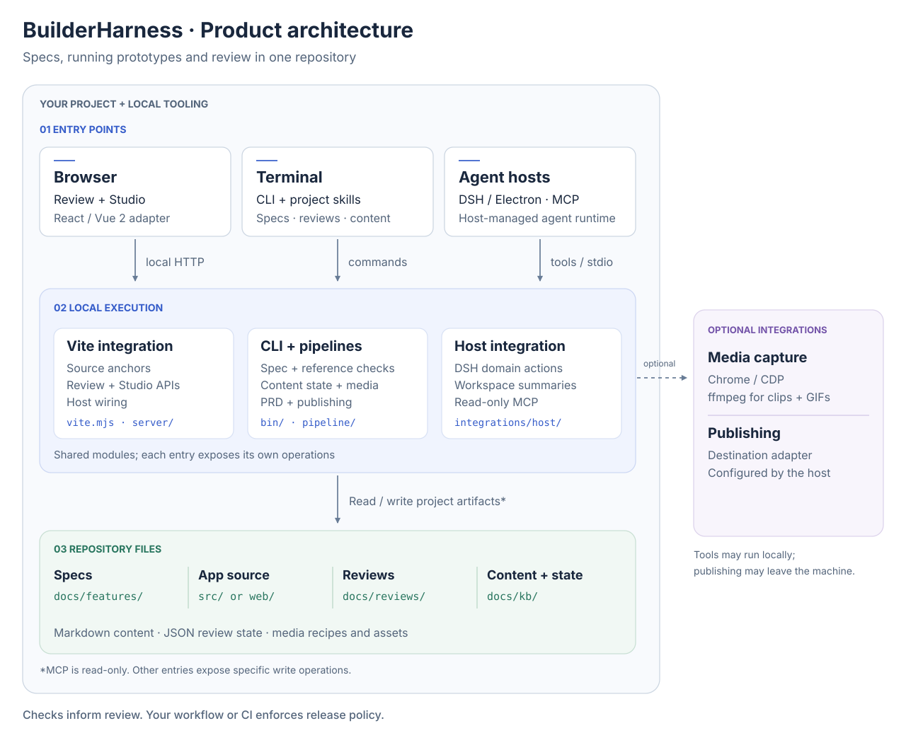

# Architecture

BuilderHarness connects feature specs, a running prototype and review through
local development tools and files in the host repository. The browser UI, CLI
and agent-host integrations offer different entry points into that workspace.



[中文架构图](./assets/architecture.zh-CN.svg)

This is a component view, not a deployment topology. Vite middleware runs in
the host's dev server; pipeline commands run as local Node.js processes. The
DSH plugin and MCP entry point run in their respective hosts. Optional media
tools can run locally, while a publishing adapter can contact an external
service.

## Entry points and request paths

| Entry point | Execution path | Access |
| :-- | :-- | :-- |
| Browser review | `client/review/` → `/__proto_review` → `server/review-server.js` → review JSON | Read/write comments |
| Browser Studio | `client/studio/` → `/__builder_studio` → `server/studio-server.js` → `pipeline/lib/` or a pipeline command | Content state, media jobs and configured publishing |
| CLI | `bin/builderharness.mjs` → `pipeline/*.mjs` → shared library modules | Depends on the selected command |
| DeepSeek Harness | `integrations/host/lib/client.js` and DSH tools → `src/dsh.mjs` → `src/service.mjs` | Workspace reads and specific domain actions |
| MCP | `integrations/host/src/mcp.mjs` → `src/project.mjs` | Read-only workspace tools and resources |

The DSH service uses `src/project.mjs` for workspace access and `src/kit.mjs`
to invoke the CLI for operations such as content confirmation and media capture.
The Electron shell launches DSH and loads its UI. It is an optional entry point,
not a prerequisite for the Vite integration.

Studio and the CLI reuse modules such as
[`pipeline/lib/content-build.mjs`](../pipeline/lib/content-build.mjs). The
agent-host reader provides workspace summaries; it does not replace the full
content validation pipeline. The MCP and DSH interfaces have different write
capabilities, as listed in the [host integration guide](../integrations/host/README.md).

## Browser and Vite integration

[`vite.mjs`](../vite.mjs) provides the `builderHarness()` plugin factory:

- Source transforms add development-only source coordinates to Vue SFC and JSX
  elements.
- `virtual:builderharness/host` exposes the feature-region registry, toolbar
  extensions, links and an optional agent-prompt prefix supplied by the host.
- The review and Studio middleware provide local HTTP endpoints.

A [React or Vue 2 adapter](./adapters.md) supplies layout slots, router state and
host controls to `mountKit()`. The toolkit creates an independent React root
under `<body>` for overlays and Studio; toolbar and drawer content use the
host-provided slots. This is DOM integration, not a security isolation boundary.

The host owns its application source, router, state and UI framework.
BuilderHarness receives project-specific wiring through the plugin and adapter
contracts.

## Repository data

| Artifact | Location | Role |
| :-- | :-- | :-- |
| Feature specifications | `docs/features/<KEY>/FRS.json` | Feature points, rules, acceptance references and screenshot definitions |
| Application source | Host application directory | Running implementation and source locations used by review |
| Review comments | `docs/reviews/<REGION>.json` | Comment text, anchors, replies and resolution status |
| Written content | `docs/kb/**/*.md` | Markdown source and references to specs or code |
| Media recipes and state | `docs/kb/shots.config.mjs`, `clips.config.mjs`, `_media.json`, `_lock.json` | Capture instructions, fingerprints and recorded confirmations |
| Publication state | `docs/kb/_published.json` | Destination IDs, URLs and published content fingerprints |

Markdown remains the source for written content. State files record workflow
metadata; they are not a second editable copy of the document. The scaffold
ignores review JSON and several generated metadata files by default, so teams
must choose what to version or share. See the [content model](./content-model.md).

## Source anchors

Review uses several locating signals, falling back when a previous location
is no longer available:

| Signal | Stored data | Purpose |
| :-- | :-- | :-- |
| Source | `src: { file, line, col }` | Link a comment to its definition in source |
| Component semantics | `componentPath`, `role`, `name` | Relocate after source or layout changes |
| Selector and geometry | Selector, `geo: { xPct, yPct }` | Approximate fallback within the anchored region |

The source transforms inject `data-loc`, `data-comp` and, for Vue component
usage sites, `data-use`. JSX transforms annotate intrinsic elements; custom
React components are not assumed to forward arbitrary props.

[`client/review/anchor.js`](../client/review/anchor.js) reports `exact`, `moved`,
`approx` or `lost`. A fallback is exposed to the reviewer rather than presented
as an exact source match.

## Checks, approval and optional integrations

There is no standalone “gate service” between review and the CLI.

- [`check-frs`](../pipeline/check-frs.mjs) checks spec structure, acceptance IDs,
  registered routes and screenshot references. It does not execute acceptance
  criteria against the application.
- [`kb check`](../pipeline/kb.mjs) checks content references and reports review
  state. Human confirmation is recorded separately.
- [`preflight`](../scripts/preflight-dist.mjs) scans generated files for known
  development artifacts, local paths and credential patterns. It is a bounded
  artifact check, not a comprehensive security audit.

Maintainers decide how these checks become release requirements in their
workflow or CI. Resolving a comment records its status; it does not by itself
prove the requested behavior was implemented.

Media commands use Chrome/CDP and, for clip processing, ffmpeg. Framework-specific
state injection and route dependency discovery come from a
[pipeline adapter](./adapters.md#pipeline-adapter).

Publishing is selected through `BUILDERHARNESS_PUBLISH_GATEWAY`. The repository
provides the contract and a `docs-cli` reference implementation. A custom
adapter owns destination access and credentials. See
[publishing.md](./publishing.md) for dry runs, confirmation and resumable state.

## Production boundary

The source-anchor plugins, host bridge and HTTP middleware use Vite's
`apply: "serve"`. Browser entry points must also use a guarded dynamic import:

```jsx
if (import.meta.env.DEV) {
  const { BuilderHarnessRoot } = await import("builderharness/react");
  // Mount the development UI here.
}
```

Keep all adapter imports inside that branch, including router helpers. Vite can
then remove the development UI during a production build. Libraries that the
host imports for its own features remain: a React app still ships React, and
explicit imports from `builderharness/ui` remain application dependencies.

Verify the actual output using the
[production-build walkthrough](./getting-started.md#check-a-production-build).
Specs, source and documentation in the diagram are project artifacts; their
presence in the diagram says nothing about whether a host chooses to publish
them.

## Maintaining the diagrams

Both SVGs are generated from one dependency-free source:

```bash
python3 docs/diagrams/render_architecture.py
```

Edit the bilingual labels and layout in
[`render_architecture.py`](./diagrams/render_architecture.py), then regenerate
`docs/assets/architecture.svg` and `docs/assets/architecture.zh-CN.svg`.
The SVGs use ordinary text and shapes, include accessible titles and
descriptions, and require no Mermaid renderer or external fonts.
